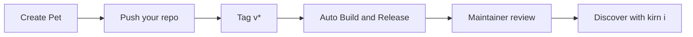

<strong>Important:</strong> the <code>pets</code> repository is an index and contribution hub. Do not hand-edit <code>registry.toml</code> to add a Pet; the registry is populated through the release and maintainer workflow described below.

## The complete path

Start with [Start here](/guide/start) for prerequisites, or jump directly to the [fork and clone workflow](/guide/fork-and-clone).

## What you will need

- Git and a GitHub account.
- A working Kirn toolchain.
- Permission to push to your fork.
- A Pet with a clear name, README, license, and runnable tests.
